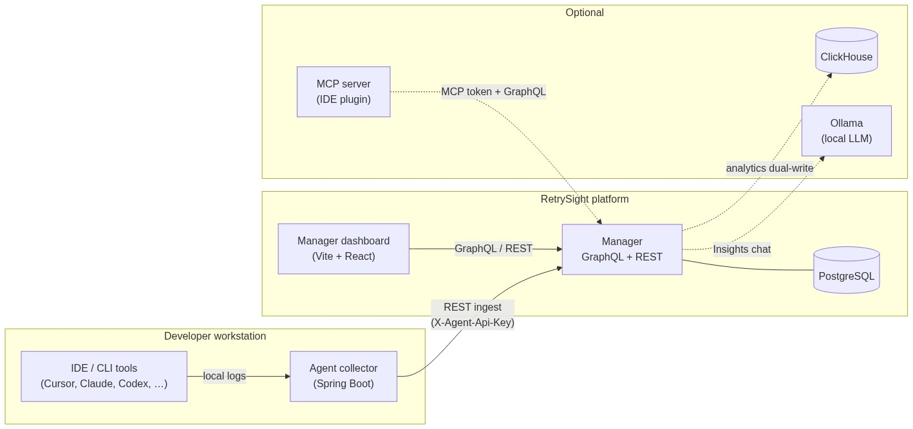
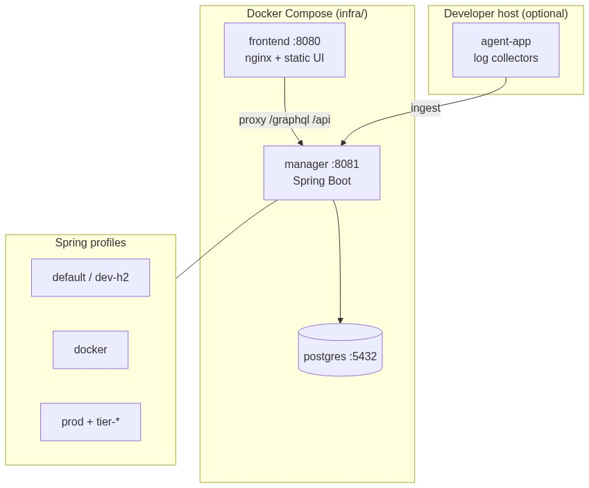
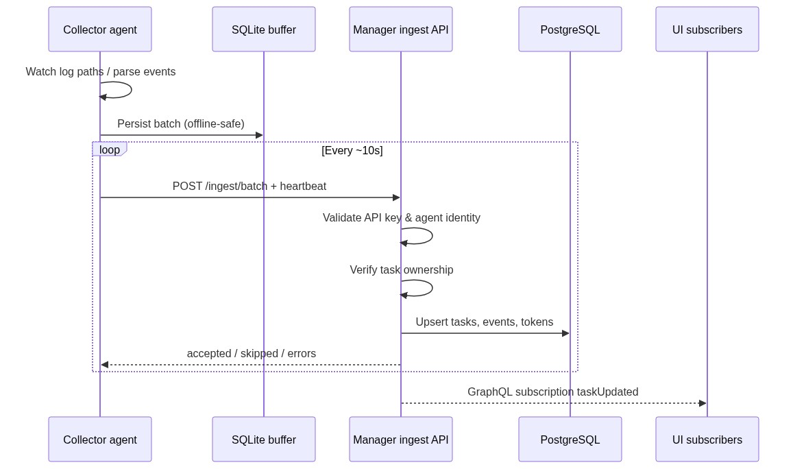
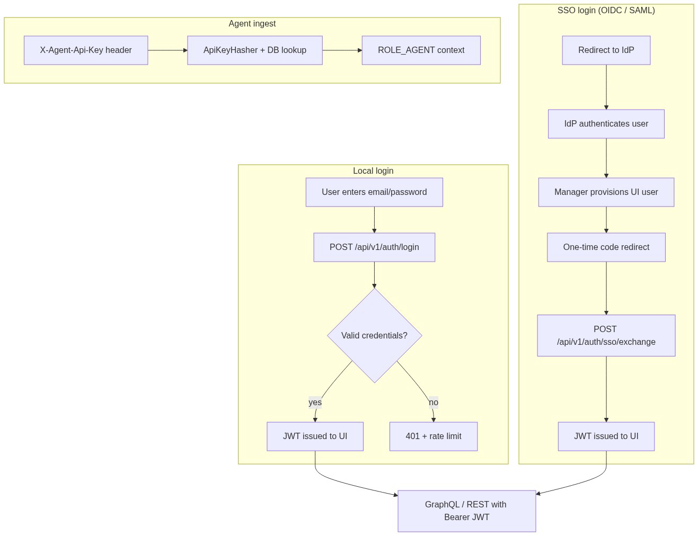
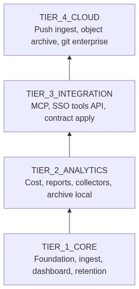

# RetrySight Platform — Functional Specification

| Field | Value |
|-------|-------|
| **Product name** | RetrySight (repository: `retrysight-tier-4-cloud`) |
| **Document version** | 1.0 |
| **Date** | July 2026 |
| **Classification** | Public — Apache-2.0 |
| **Status** | As-built specification |

---

## 1. Purpose and scope

### 1.1 Purpose

This document describes the **functional behaviour** of RetrySight: an observability platform that tracks coding-agent retries, token usage, and session activity across developer machines. It is intended for product owners, engineers, operators, and security reviewers who need a single reference for what the system does—not how every line of code is implemented.

### 1.2 In scope

- End-to-end data collection from supported AI coding tools
- Central manager (ingest, storage, GraphQL API, auth)
- Web dashboard (analytics, live feed, admin)
- MCP integration for IDE assistants
- Optional analytics (ClickHouse), Insights chat (Ollama), OTel (Claude Cowork)
- Installation tiers and feature gating
- Authentication, authorization, and security controls (summary)

### 1.3 Out of scope

- Detailed API OpenAPI schemas (see GraphQL schema and REST controllers in source)
- Commercial pricing and licensing terms
- Step-by-step runbooks (see `docs/VALIDATION.md`, `infra/README.md`)

---

## 2. Executive summary

RetrySight answers three questions for engineering leaders and platform teams:

1. **Where are developers retrying AI-assisted work?** (edits, test failures, rejected diffs, compaction)
2. **What does it cost in tokens and estimated USD?** (per model, per user, per tool)
3. **Which agents and collectors are active on the fleet?** (heartbeats, stale detection)

Developers run a lightweight **agent collector** on their workstation. It tails local log files from Cursor, Claude Code, Codex, Kiro, Warp, Copilot, and related tools, buffers events in SQLite, and pushes batches to a central **manager**. The **dashboard** provides KPIs, task timelines, cost views, live subscriptions, evaluations, and admin controls.

---

## 3. Stakeholders and user roles

| Role | Description | Primary interfaces |
|------|-------------|-------------------|
| **Developer** | Runs agent collector; may use MCP tools in IDE | Agent app, MCP |
| **Engineering manager / PM** | Views dashboards, cost, retries | Web UI (`UI`) |
| **Platform admin** | Manages API keys, SSO, budgets (where enabled) | Web UI (`ADMIN`) |
| **Security admin** | Break-glass login, SSO config, security settings | Web UI + config (`SECADMIN`) |
| **Agent process** | Automated ingest | REST (`ROLE_AGENT` via API key) |

### 3.1 Role capabilities (summary)

| Capability | UI | ADMIN | SECADMIN | AGENT |
|------------|:--:|:-----:|:--------:|:-----:|
| View dashboard, tasks, agents | ✓ | ✓ | ✓ | — |
| Session replay (UI) | ✓ | ✓ | ✓ | — |
| Security / SSO admin | — | — | ✓ | — |
| API key management | — | — | ✓ | — |
| Eval experiment run (mutations) | — | ✓ | ✓ | — |
| Ingest events / tokens | — | — | — | ✓ |
| Chat audit log | — | — | ✓ | — |

---

## 4. System context



**Figure 1 — System context.** Developer tools produce logs; the agent collector forwards normalized events to the manager. The dashboard and optional MCP/Insights/ClickHouse consume manager APIs.

---

## 5. Architecture overview

### 5.1 Logical components

| Component | Technology | Responsibility |
|-----------|------------|----------------|
| `shared/agent-contract` | Java records/DTOs | Shared ingest and domain types |
| `agent/agent-app` | Spring Boot | Log watchers, SQLite buffer, batch uploader |
| `manager/manager-app` | Spring Boot, GraphQL, JPA | Ingest, auth, queries, subscriptions, admin |
| `ui/manager-dashboard` | Vite, React, Tremor | Observability console |
| `mcp/` | TypeScript MCP server | IDE tools/resources over manager API |
| `infra/` | Docker, nginx, scripts | Compose stack, images, deployment |

### 5.2 Deployment topology



**Figure 2 — Typical Docker deployment.** Frontend nginx serves the UI and proxies API traffic to the manager. PostgreSQL is the system of record. The agent may run on the host or in a optional container profile.

---

## 6. Core data flows

### 6.1 Ingest pipeline



**Figure 3 — Ingest pipeline.** The agent buffers locally, then sends idempotent batches. The manager validates the API key, binds events to the authenticated agent, and persists to PostgreSQL.

**Functional requirements (ingest):**

| ID | Requirement |
|----|-------------|
| ING-01 | Agent SHALL register via heartbeat with hostname and developer email when no `X-Agent-Id` is known |
| ING-02 | Agent SHALL send `X-Agent-Api-Key` on all ingest and OTel requests |
| ING-03 | Manager SHALL reject ingest writes to tasks not owned by the authenticated agent |
| ING-04 | Manager SHALL deduplicate items by idempotency key (skip duplicates) |
| ING-05 | Manager SHALL accept task start, task event, token usage, and task complete item types |
| ING-06 | Agent SHALL retry uploads after manager outage using SQLite buffer |

### 6.2 Supported source tools

| SourceTool | Collection method (agent) |
|------------|---------------------------|
| CURSOR | Transcript / tool logs |
| CLAUDE_CODE | Session JSONL |
| CLAUDE_COWORK | OTel push to manager (optional) |
| CODEX | CLI event stream |
| KIRO | CLI session JSONL |
| WARP | Agent mode SQLite |
| COPILOT | CLI events JSONL |
| WINDSURF, CONTINUE, CLINE, AIDER, OPENCODE, KIRO_IDE | Registry / extensible collectors |

### 6.3 Task event types

| TaskEventType | Meaning |
|---------------|---------|
| EDIT | File edit / retry signal |
| TEST_FAIL | Test failure during session |
| DIFF_REJECTED / DIFF_ACCEPTED | User diff decision |
| SUBAGENT | Sub-agent invocation |
| TOKEN_USAGE | Token accounting event |
| SESSION_START / SESSION_END | Session boundaries |
| COMPACTION | Context compaction |

---

## 7. Authentication and authorization



**Figure 4 — Authentication paths.**

### 7.1 Local login

- Config-file **secadmin** account (`SECADMIN_EMAIL` / `SECADMIN_PASSWORD`) provides break-glass access when SSO is unavailable.
- Password verified with bcrypt; JWT issued with role `SECADMIN`.
- Rate limiting applies to failed login attempts per client IP.

### 7.2 SSO (OIDC / SAML)

- IdP configuration stored encrypted in PostgreSQL (`SSO_SECRET_KEY`).
- On success, user provisioned as `UI` or `SECADMIN` (superuser group mapping).
- Redirect uses **one-time authorization code** exchanged via `POST /api/v1/auth/sso/exchange` (JWT not placed in URL query string).

### 7.3 Agent API keys

- Fleet-wide `AGENT_API_KEY` or per-key rows in `api_keys` table.
- Keys stored as HMAC-SHA256 hashes (`h1:` prefix); legacy hashes migrated on use.
- Rotation supports dual-key grace window (`API_KEY_ROTATION_GRACE_SECONDS`).

### 7.4 Session replay access

- `GET /api/v1/tasks/{id}/replay` requires UI, ADMIN, or SECADMIN JWT.
- Agent API keys alone SHALL NOT fetch session replay (prompt exfiltration control).

---

## 8. Manager — functional areas

### 8.1 REST APIs

| Area | Base path | Auth |
|------|-----------|------|
| Auth | `/api/v1/auth/*` | Public (login, SSO exchange, MCP token) |
| Ingest | `/api/v1/ingest/*` | Agent API key |
| OTel | `/api/v1/otel/*` | Agent API key |
| Reports | `/api/v1/reports/*` | JWT (UI+) |
| Chat | `/api/v1/chat/*` | JWT (UI+); audit SECADMIN only |
| Contracts | `/api/v1/contracts/*` | JWT (ADMIN+) |
| Admin | `/api/v1/admin/*` | SECADMIN |
| Task replay | `/api/v1/tasks/{id}/replay` | JWT (UI+) |

### 8.2 GraphQL API

| Category | Examples |
|----------|----------|
| **Queries** | `agents`, `tasks`, `task`, `dashboardSummary`, `costSummary`, `platformFeatures`, eval datasets |
| **Mutations** | `login`, eval definitions, experiments (ADMIN+ for run mutations) |
| **Subscriptions** | `taskUpdated`, `agentHeartbeat` (WebSocket at `/graphql`) |

### 8.3 Insights chat (optional)

When `CHAT_ENABLED=true` and Ollama is reachable:

- UI drawer (⌘J) streams SSE from `POST /api/v1/chat`.
- Orchestrator calls tools: dashboard summary, cost, retries, tasks, replay excerpt, reports.
- Deterministic fallback when Ollama is unavailable.
- Privacy redaction on paths, tokens, and emails before LLM context.

### 8.4 Evaluations and experiments

- Online evals may run on task completion.
- Manual eval runs, playground, and experiment execution require ADMIN or SECADMIN.
- Datasets, annotation queue, scorecards, and topic patterns (tier-gated).

### 8.5 Reports and cost

- Export executive summary, task lists, retry waste, token cost (CSV/JSON/PDF) when tier allows.
- Cost estimates use model pricing registry (including Chinese LLM tiers).
- Optional ClickHouse dual-write for analytics at scale.

### 8.6 Retention and archive

- Configurable task-event retention (`RETENTION_TASK_EVENTS_DAYS`).
- Scheduled archive jobs (local, network, or object storage by tier).

---

## 9. Dashboard — pages and user journeys

| Route | Page | Primary functions |
|-------|------|-------------------|
| `/` | Dashboard | KPIs, charts, top retry tasks |
| `/live` | Live | Real-time task/agent subscriptions |
| `/tasks` | Tasks | Filterable task list |
| `/tasks/:id` | Task detail | Timeline, tokens, replay panel, evals |
| `/agents` | Agents | Fleet status, stale heartbeats |
| `/cost` | Cost | Spend by model/user (tier 2+) |
| `/retries` | Retries | Retry analysis (tier 2+) |
| `/reports` | Reports | Report generation |
| `/evaluations` | Evaluations | Eval definitions and runs |
| `/experiments` | Experiments | A/B eval experiments |
| `/playground` | Playground | Ad-hoc eval (ADMIN+) |
| `/traces` | Traces | OTel span view |
| `/patterns` | Patterns | Topic clustering |
| `/admin/security` | Security | SSO / IdP (SECADMIN) |
| `/admin/api-keys` | API keys | Key lifecycle (SECADMIN) |
| `/admin/archive` | Archive | Retention policy (SECADMIN) |

**Typical journey — engineering lead:**

1. Log in (local or SSO).
2. Open Dashboard → review weekly retry rate and token spend.
3. Drill into Tasks → filter high-retry sessions.
4. Open Task detail → inspect event timeline and session replay.
5. Optional: ask Insights chat “Who spent the most this week?”

---

## 10. Installation tiers and feature gating



**Figure 5 — Installation tiers.** Higher tiers include lower-tier capabilities when feature flags are enabled.

| Tier | Profile | Capabilities unlocked |
|------|---------|------------------------|
| **TIER_1_CORE** | `tier-core` | Ingest, dashboard, tasks, agents, live, retention |
| **TIER_2_ANALYTICS** | `tier-analytics` | + Cost, reports, collectors, archive local, git capture |
| **TIER_3_INTEGRATION** | `tier-integration` | + MCP, SSO tools API, contract cost apply, git query |
| **TIER_4_CLOUD** | `tier-cloud` | + Push ingest, object archive, git enterprise |

The active tier is exposed via GraphQL `platformFeatures` and enforced server-side by `FeatureGateService`.

---

## 11. MCP integration

The MCP server (`mcp/`) connects IDEs (Cursor, VS Code, Kiro) to the manager:

1. Obtain MCP JWT via `POST /api/v1/auth/mcp-token` (requires MCP feature + valid user login).
2. Configure IDE with `APM_MCP_TOKEN` and repo path.
3. Tools include task listing, dashboard summary, report preview (see `mcp/README.md`).

---

## 12. Non-functional requirements

| ID | Category | Requirement |
|----|----------|-------------|
| NFR-01 | Availability | Agent buffering SHALL prevent data loss during short manager outages |
| NFR-02 | Performance | Ingest rate limits configurable (`SECURITY_INGEST_RPM`) |
| NFR-03 | Security | Default secrets rejected on prod/staging/docker without override |
| NFR-04 | Security | CSRF disabled for Bearer-token APIs; CORS allow-list per environment |
| NFR-05 | Scalability | Optional ClickHouse for analytics reads; Postgres remains OLTP |
| NFR-06 | Observability | Manager structured logging; chat audit for SECADMIN |
| NFR-07 | Portability | BYO RDBMS: PostgreSQL (default), MySQL, SQL Server, Oracle |
| NFR-08 | Privacy | Configurable redaction of project roots and full prompts |

---

## 13. Data model (conceptual)

```
Organization (org_id, optional)
  └── Agent (hostname, developer_email, api_key_hash, heartbeats)
        └── Task (source_tool, external_session_id, status, retry_count)
              ├── TaskEvent (event_type, payload, sequence, idempotency_key)
              └── TokenUsage (model, input/output tokens, estimated_cost_usd)

UiUser (email, role, SSO subject)
ApiKey (key_hash, role, grace_until)
IdentityProviderConfig (OIDC/SAML, encrypted secrets)
```

Tasks from the same IDE session may alias to a canonical task ID when collectors emit different UUIDs for one session.

---

## 14. Environment and configuration

| Variable | Purpose |
|----------|---------|
| `MANAGER_PORT` | Manager HTTP port (default **28477**) |
| `FRONTEND_PORT` | Dashboard port (Docker **8080**, Vite **5173**) |
| `JWT_SECRET` | JWT signing key |
| `AGENT_API_KEY` | Fleet agent ingest key |
| `SECADMIN_PASSWORD` | Break-glass admin password |
| `SSO_SECRET_KEY` | Encrypt IdP client secrets at rest |
| `CLICKHOUSE_ENABLED` | Dual-write analytics |
| `CHAT_ENABLED` / `OLLAMA_BASE_URL` | Insights chat |
| `SECURITY_ALLOW_DEFAULT_SECRETS` | Local Docker dev only |

---

## 15. Validation and acceptance

Acceptance testing is defined in `docs/VALIDATION.md` (smoke checks S1–S12, tier matrix, capacity probe). Minimum release criteria:

- All smoke checks pass on local stack
- Tier matrix verified for shipped profile
- Security checklist in `docs/SECURITY.md` reviewed
- Maven unit tests and UI production build succeed

---

## 16. Glossary

| Term | Definition |
|------|------------|
| **Task** | One AI coding session (may map 1:1 to an IDE conversation) |
| **Retry** | Incremented on retry-flagged events (edits, failures, etc.) |
| **Collector** | Agent module watching a specific tool's log format |
| **Replay** | Serialized session transcript for humans or downstream LLM eval |
| **Idempotency key** | Client-supplied key preventing duplicate event rows |
| **Grace window** | Period where old API key remains valid after rotation |

---

## 17. Related documents

| Document | Topic |
|----------|-------|
| `README.md` | Quick start and ports |
| `docs/SECURITY.md` | Security checklist |
| `docs/VALIDATION.md` | Test plan |
| `docs/CHATBOT.md` | Insights chat |
| `docs/COWORK_OTEL.md` | Claude Cowork OTel |
| `infra/README.md` | Docker deployment |

---

*Copyright © 2026 Arka Prava Ghosh. Licensed under the Apache License, Version 2.0.*
